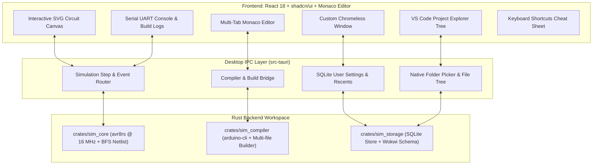

# MicroRustSim

<div align="center">

[](https://www.rust-lang.org/)
[](https://tauri.app/)
[](https://react.dev/)
[](https://ui.shadcn.com/)
[](https://microsoft.github.io/monaco-editor/)
[](https://github.com/avr8rs/avr8rs)
[](https://github.com/rusqlite/rusqlite)
[](LICENSE)
[](https://github.com/PichyyyNews/MicroRustSim)

**A high-performance, cycle-accurate embedded microcontroller & circuit simulator built in Pure Rust + Tauri v2 + React (shadcn/ui).**  
*Native-first, local-first, low-latency, and engineer-grade.*

[Features](#-key-features) • [Starter Templates](#-starter-project-templates) • [Architecture](#-architecture) • [Design System](#-design-system--visual-hierarchy) • [Keyboard Shortcuts](#-keyboard-shortcuts) • [Quickstart](#-quickstart) • [Design Guide (DESIGN.md)](DESIGN.md) • [Agent Guidelines (AGENTS.md)](AGENTS.md)

</div>

---

## 📖 Overview

**MicroRustSim** brings the fluid, interactive experience of circuit simulators like Wokwi and Tinkercad to a blazingly fast desktop environment powered by **Pure Rust**, **Tauri v2**, **React 18**, and **shadcn/ui**.

Designed specifically for electronics engineers, hobbyists, educators, and embedded firmware developers, MicroRustSim pairs **genuine cycle-accurate AVR microcontroller emulation** with a real local C++ compiler toolchain (`arduino-cli`), an electrical netlist engine, a **VS Code-style project working folder**, and a monochrome dark-mode IDE.

```
┌──────────────────────────────────────────────────────────────────────────────────────────────┐
│  ▶  ⏸  ⚡  ⟳  |  [V] [M] [W] [E] [R] [F]  |  sketch.ino* • My_Arduino_Lab           [?]     │
├─────────────────────┬───────────────────────────────────────────────────┬────────────────────┤
│  EXPLORER           │                   CANVAS                          │  PALETTE           │
│  ▾ My_Arduino_Lab   │                                                   │  ▸ Core Processing │
│    sketch.ino       │           Arduino Uno R3         Breadboard       │  ▸ Prototyping     │
│    config.h         │          ┌───────────────┐     ┌──────────────┐   │  ▸ Outputs (LEDs)  │
│    diagram.json     │          │ D13 ──────────┼─────┤ LED (Red)    │   │  ▸ Passives        │
│    project.json     │          │ GND ──────────┼─────┤ Resistor 220 │   │  ▸ Inputs          │
│    README.md        │          └───────────────┘     └──────────────┘   ├────────────────────┤
│    .gitignore       │                                                   │  PROPERTIES        │
├─────────────────────┴───────────────────────────────────────────────────┤  LED: Red (Pin 13) │
│  >_ Serial Monitor    ∿ Logic Waveform    ⚙ Build Output       [Copy]   │  Forward: 2.10 V   │
│  [14:10:02] USART Online @ 9600 Baud. System Initialized.               │  Current: 13.2 mA  │
│  [14:10:03] LED: HIGH [████████████████████] 5.00V                      └────────────────────┘
└──────────────────────────────────────────────────────────────────────────────────────────────┘
```

---

## ✨ Key Features

### ⚡ 1. Cycle-Accurate AVR ATmega328P Emulation
- Powered by `avr8rs` executing instructions at real 16 MHz hardware timing.
- Cycle-accurate digital I/O registers (`PORTB`, `PORTC`, `PORTD`), hardware timers (`Timer0`, `Timer1`, `Timer2`), 10-bit analog-to-digital converter (ADC), interrupts, and memory-mapped registers.

### 📁 2. VS Code-Style Project Explorer & Working Folders
- **Working Folder Architecture**: Select any project directory on your drive using native Windows Explorer folder picker (`rfd`).
- **Starter Scaffolding**: Automatically creates standard project files on setup:
  - `sketch.ino`: Main firmware setup and loop routines.
  - `config.h`: Hardware pin definitions and baud constants.
  - `diagram.json`: Complete circuit schematic and breadboard wiring (Wokwi-compatible).
  - `project.json`: Target MCU metadata, board FQBN (`arduino:avr:uno`), and clock configurations.
  - `README.md`: Project documentation and pinout notes.
  - `.gitignore`: Standard embedded ignore rules (`build/`, `*.hex`, `*.elf`).
- **File Tree Navigation**: Collapsible recursive folder tree (`▸/▾`), file type icons, inline New File / New Folder creation, Collapse All, and Refresh.

### 📝 3. Multi-Tab Monaco Code Editor
- Open and edit multiple files concurrently (`[sketch.ino ×] [config.h ×] [diagram.json ×]`).
- Visual dirty dot indicator (`●`) for unsaved modifications.
- Dynamic syntax highlighting for C++ (`.ino`, `.cpp`, `.h`), JSON (`.json`), and Markdown (`.md`).
- Quick shortcuts: `Ctrl+S` to save all open files and circuit changes; `Ctrl+O` to open a folder.

### 🛠️ 4. Genuine Arduino Toolchain Integration
- Compiles real sketches down to AVR Intel HEX using local `arduino-cli` (located in `%LOCALAPPDATA%\MicroRustSim\tools`).
- **Multi-File Header Support**: Automatically forwards companion project files (`config.h`, user libraries) directly into the compilation pipeline.
- Automatic ANSI escape sequence cleaning for crystal-clear compiler outputs without terminal garble (`[92M`, `[0m`).

### 🔌 5. Interactive Components & Precision Wiring
- **Arduino Uno R3**: ATmega328P @ 16 MHz with accurate pinout headers.
- **Half Breadboard**: 30 rows with linked power rails (+ / -) and 5-hole terminal columns.
- **LEDs**: Dynamic forward-voltage glow (Red, Green, Blue, Yellow, White) calculated from cathode/anode electrical potential.
- **Resistors**: Customizable resistance (220Ω, 1kΩ, 10kΩ, etc.) with real-time color code band recalculation.
- **Pushbuttons**: Interactive tactile switches with momentary click/spring-back action.
- **Potentiometers**: Rotatable 10k knob with real-time wiper voltage division (0.0V – 5.0V) fed directly into the ADC.
- **Orthogonal & Curved Wire Routing**: Canva/CAD-style orthogonal 90° right-angle routing with movable mid-wire segment dragging, waypoint additions, and color palette.
- **Eraser Tool (`E`)**: One-click removal of individual components or wire runs.

### 📊 6. Text-Selectable Terminal & Waveform Monitor
- **Serial Monitor**: Non-blocking hardware UART register hook streaming ASCII logs at configurable baud rates (9600, 115200).
- **Text Selection & 1-Click Copy**: Full drag-to-select text cursor with a dedicated **Copy Output** button for immediate clipboard export.
- **Digital Logic Waveform**: High-DPI digital oscilloscope tracking pin voltage states over time.

### 💾 7. Local-First SQLite Workspace Persistence
- Panel sizes, drawer collapse states, and user preferences saved into local SQLite database (`%LOCALAPPDATA%\MicroRustSim\projects.db`).
- **Reset Layout to Default**: Instant layout recovery available in the top menubar View menu.

---

## 📦 Starter Project Templates

When creating a new project, MicroRustSim provides 5 pre-built templates ready to run out of the box:

| Template | Type | Included Hardware | Description |
| :--- | :--- | :--- | :--- |
| **Blink (LED Pin 13)** | Starter | Uno R3, Breadboard, Red LED, 220Ω Resistor | Standard ATmega328P digital output. Blinks LED on Pin 13 every 1s. |
| **Pushbutton Toggle** | Interactive | Uno R3, Breadboard, Tactile Button, Green LED | Digital input with internal pull-up and debouncing to toggle LED. |
| **Potentiometer ADC** | Analog | Uno R3, Breadboard, 10k Potentiometer | Reads 10-bit analog conversion (0–1023) on A0 and logs voltage to UART. |
| **Traffic Light Sequencer** | Multi-LED | Uno R3, Breadboard, Red/Yellow/Green LEDs, Resistors | Timed 3-state traffic controller: Red (3s) -> Green (3s) -> Yellow (1s). |
| **Blank Canvas** | Minimal | Uno R3, Half Breadboard | Clean workspace for custom schematics and firmware from scratch. |

---

## 🏛 Architecture

MicroRustSim is designed as a modular workspace cleanly separating hardware simulation, compiler tooling, persistence, and UI:



### Workspace Structure

| Crate / Module | Responsibility | Key Technologies |
| :--- | :--- | :--- |
| **`crates/sim_core`** | MCU cycle clock, electrical netlist solver, pin states, component physics | `avr8rs`, zero-alloc BFS |
| **`crates/sim_compiler`** | Multi-file sketch compilation, Intel HEX validation, ANSI stripping | `arduino-cli`, `std::process` |
| **`crates/sim_storage`** | Project directory manager, starter scaffolding, SQLite storage | `rusqlite`, `serde_json` |
| **`src-tauri`** | Low-latency async IPC channels, native dialogs, window lifecycle | `tauri 2.2`, `rfd` |
| **`src/`** | React interface, Monaco multi-tab editor, circuit renderer, panels | `@monaco-editor/react`, Tailwind CSS |

---

## 🎨 Design System & Visual Hierarchy

Strictly adhering to [`AGENTS.md`](AGENTS.md) and [`DESIGN.md`](DESIGN.md):

- **Flat Dark Monochrome Zinc**: Distraction-free internal IDE aesthetic (`#09090b`, `#121215`, `#18181b`, `#222226`).
- **Icon-First Low-Text Density**: Based on **GitHub Octicons** (`react-icons/go`). Buttons use recognizable glyphs with succinct tooltips.
- **Zero Blue Focus Borders**: Crisp monochrome zinc borders (`#27272a`) with white active accents.
- **Zero-Latency Modals**: Floating dialogs utilize direct GPU DOM transform dragging (`translate3d`) and pointer capture, achieving 144Hz/240Hz fluid movement with zero React re-render lag.

---

## ⌨️ Keyboard Shortcuts

Hover or click the subtle **`?`** badge in the top-right corner of the canvas to open the in-app cheat sheet:

| Shortcut | Action | Description |
| :--- | :--- | :--- |
| **`V`** | Select Tool | Select, reposition, or configure components |
| **`M`** | Move Tool | Pan the canvas view |
| **`W`** | Wire Tool | Draw new wires between connection pins |
| **`E`** | Eraser Tool | Click any component or wire to delete |
| **`R`** | Rotate Component | Rotate the selected component 90° clockwise |
| **`F`** | Flip Component | Horizontally flip the selected component |
| **`Del` / `Backspace`** | Delete Selected | Remove the active component or wire run |
| **`Space + Drag`** | Pan Canvas | Quick pan across the circuit view |
| **`Mouse Wheel`** | Zoom Canvas | Smooth zoom centered on cursor |
| **`Ctrl + S`** | Save Project | Save code, config, and circuit changes |
| **`Ctrl + O`** | Open Folder | Browse and open working project folder |

---

## 🚀 Quickstart

### Prerequisites

- [Rust & Cargo](https://rustup.rs/) (1.80 or newer)
- [Node.js](https://nodejs.org/) (v18 or newer)
- Windows / macOS / Linux

### Installation & Development

```bash
# 1. Clone the repository
git clone https://github.com/PichyyyNews/MicroRustSim.git
cd MicroRustSim

# 2. Install frontend dependencies
npm install

# 3. Launch the Tauri v2 Desktop App
npm run tauri dev
```

### Verification & Testing

```bash
# Run Rust automated test suite
cargo test --all

# Build frontend production bundle
npm run build
```

---

## 📄 License

Distributed under the MIT License. See [LICENSE](LICENSE) for more details.

---

<div align="center">
Developed with ❤️ by <a href="https://github.com/PichyyyNews">PichyyyNews</a>
</div>
