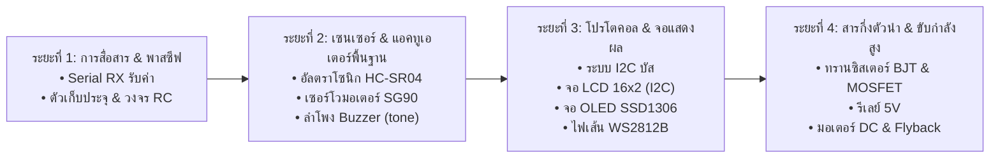

# MicroRustSim: Next-Phase Roadmap & Component Specification (ROADMAP.md)

เอกสารแผนพัฒนาฟีเจอร์ถัดไปและข้อกำหนดการทำงานของอุปกรณ์ใหม่สำหรับ **MicroRustSim** เพื่อยกระดับความสามารถในการจำลองระบบสมองกลฝังตัวและวงจรไฟฟ้าให้ครอบคลุมการเรียนการสอน การทดลองโครงงานจริง และการพัฒนาเฟิร์มแวร์ระดับวิศวกรรม

---

## 1. รายการระบบหลักที่ต้องทำต่อ (Core Engine & System Tasks)

### 1.1 ระบบสื่อสาร Serial แบบสองทาง (Bidirectional Serial Monitor RX)
- **ปัญหาปัจจุบัน**: ปัจจุบันฝั่งบอร์ดส่งข้อความออกมาแสดงบนจอได้ (TX) แต่ผู้ใช้ยังไม่สามารถพิมพ์ข้อความใน Serial Monitor ส่งกลับเข้าไปให้บอร์ดอ่านด้วย `Serial.read()` ได้
- **งานที่ต้องทำ**:
  1. เพิ่มช่องรับข้อความ (Input field) พร้อมปุ่ม Send ใน `src/components/` (Terminal Drawer)
  2. เชื่อมต่อ Tauri IPC Command `send_serial_input(text: String)`
  3. ใน `crates/sim_core/src/lib.rs` นำไบต์ที่ได้ป้อนเข้าคิว RX Buffer และทริกเกอร์สถานะของรีจิสเตอร์ USART (`UCSR0A` RXC flag) และสร้าง USART RX Complete Interrupt เข้าสู่ AVR CPU core

### 1.2 ระบบจำลองโปรโตคอลฮาร์ดแวร์ (Hardware Protocol Layer: I2C & SPI)
- **ปัญหาปัจจุบัน**: พิน A4/A5 และ D10-D13 ทำงานได้เฉพาะระดับ Digital/Analog I/O ทั่วไป แต่ยังไม่รองรับการจำลองโปรโตคอลบัสอนุกรมความเร็วสูง
- **งานที่ต้องทำ**:
  1. **I2C / TWI Engine**:
     - ตรวจจับการเขียน/อ่านรีจิสเตอร์ `TWCR`, `TWDR`, `TWSR`, `TWBR` ของ ATmega328P
     - จำลองสถานะ Start, Repeated Start, Address Match, ACK/NACK, Data Transmission, Stop Condition
     - เชื่อมโยงอุปกรณ์ Slave ภายนอกตาม Address เช่น `0x27` (I2C LCD), `0x3C` (OLED SSD1306)
  2. **SPI Engine**:
     - ตรวจจับรีจิสเตอร์ `SPCR`, `SPSR`, `SPDR`
     - ถ่ายโอนไบต์ตามสัญญาณนาฬิกา SCK และสายข้อมูล MOSI/MISO ในแต่ละโหมด (Mode 0-3)

### 1.3 ยกระดับ MNA Solver รองรับผลทางเวลาและตัวเหนี่ยวนำ/ตัวเก็บประจุ (Transient Analysis & Reactive Elements)
- **ปัญหาปัจจุบัน**: ตัวแก้สมการวงจร MNA ปัจจุบันเป็น DC Steady-State ($\mathbf{G}\mathbf{v} = \mathbf{j}$) คำนวณเฉพาะความต้านทานและไดโอด
- **งานที่ต้องทำ**:
  1. อัปเกรดเป็นตัวแก้สมการแบบเชิงตัวเลขข้ามเวลา (Numerical Integration: Backward Euler / Trapezoidal Rule)
  2. แปลงสมการอนุพันธ์ของตัวเก็บประจุ ($I = C \frac{dV}{dt}$) และตัวเหนี่ยวนำ ($V = L \frac{dI}{dt}$) ให้อยู่ในรูปตัวนำสมมูล (Companion Models):
     $$G_{C} = \frac{C}{\Delta t}, \quad I_{C}(t) = \frac{C}{\Delta t} V(t - \Delta t)$$
     $$G_{L} = \frac{\Delta t}{L}, \quad I_{L}(t) = I(t - \Delta t)$$
  3. รองรับการจำลองวงจรหน่วงเวลา RC, ตัวกรองสัญญาณ Decoupling, และแรงดันไฟฟ้าย้อนกลับ (Back-EMF) จากขดลวด

### 1.4 การบันทึกหน่วยความจำถาวร EEPROM (Non-Volatile Storage)
- **งานที่ต้องทำ**:
  1. เพิ่มตารางหรือไฟล์ไบนารีจำลองเนื้อที่ EEPROM ขนาด 1KB ของ ATmega328P
  2. จัดการคำสั่งผ่านรีจิสเตอร์ `EEAR`, `EEDR`, `EECR` ให้ทำงานได้กับไลบรารี `<EEPROM.h>`
  3. บันทึกข้อมูลลงฐานข้อมูล SQLite ในเครื่อง (`projects.db`) เพื่อให้ค่าคงอยู่แม้จะรีเซ็ตหรือปิดโปรแกรม

### 1.5 ระบบจัดการไลบรารี Arduino ในโปรแกรม (In-App Arduino Library Manager)
- **แนวคิด**: เพิ่มหน้าต่างจัดการไลบรารีในโปรแกรมเพื่อค้นหาและติดตั้งไลบรารีทางการของ Arduino ได้ทันทีเหมือน Arduino IDE โดยไม่ต้องเปิด Command Line
- **งานที่ต้องทำ**:
  1. **IPC Bridge & Backend Commands (`src-tauri`)**:
     - `search_libraries(query: String)`: รัน `arduino-cli lib search "<query>" --format json`
     - `install_library(name: String)`: รัน `arduino-cli lib install "<name>"`
     - `list_installed_libraries()`: รัน `arduino-cli lib list --format json`
     - `uninstall_library(name: String)`: รัน `arduino-cli lib uninstall "<name>"`
  2. **Frontend UI Modal (`src/components/LibraryManagerModal.tsx`)**:
     - คีย์ลัด `Ctrl+Shift+I` หรือเมนู Tools -> Manage Libraries...
     - ช่องค้นหา (Search Bar) พร้อมตัวกรองหมวดหมู่ (Display, Sensors, Communication ฯลฯ)
     - รายการการ์ดไลบรารี แสดงชื่อ, เวอร์ชันล่าสุด, ผู้พัฒนา, รายละเอียดสั้น และปุ่ม `Install` / `Installed` / `Remove`
     - แถบแสดงสถานะกำลังดาวน์โหลดและติดตั้งแบบ Real-time

---

## 2. อุปกรณ์ที่ต้องเพิ่มพร้อมพฤติกรรม (Component Catalog & Behaviors)

### หมวดที่ 1: อุปกรณ์พาสซีฟและสารกึ่งตัวนำ (Passives & Discrete Semiconductors)

#### 1. ตัวเก็บประจุ (Capacitor)
- **ประเภท**: เซรามิก (Ceramic: 100nF, 10nF) และอิเล็กโทรไลต์ (Electrolytic Polarized: 10µF, 100µF, 470µF)
- **พิน**: 2 ขา (ขั้วบวก Anode `+` / ขั้วลบ Cathode `-` สำหรับแบบมีขั้ว)
- **พฤติกรรมไฟฟ้า**:
  - ประจุและคายประจุตามสมการ $V(t) = V_0 (1 - e^{-t/RC})$
  - สำหรับชนิดมีขั้ว: ตรวจจับ Fault **ReversePolarity** เมื่อต่อขั้วลบเข้าศักย์ไฟฟ้าสูงกว่าขั้วบวก และ Overvoltage เมื่อแรงดันเกินพิกัด (เช่น เกิน 16V/25V)
  - ความต้านทานภายในสมมูล (ESR $\approx 0.1\,\Omega - 1\,\Omega$)

#### 2. ไดโอดและซีเนอร์ไดโอด (Rectifier Diode & Zener Diode)
- **เบอร์ตัวแทน**: 1N4007 (ไดโอดเรียงกระแส), 1N4148 (สวิตชิ่ง), Zener 5.1V
- **พิน**: 2 ขา (`anode`, `cathode`)
- **พฤติกรรมไฟฟ้า**:
  - นำกระแสทิศทางเดียวด้วยแรงดันตกคร่อมไปข้างหน้า $V_f \approx 0.7\text{V}$ (Silicon)
  - โมเดล Shockley Diode แบบไม่เป็นเชิงเส้นผ่าน Newton-Raphson
  - ซีเนอร์ไดโอด: นำกระแสย้อนกลับแบบควบคุมแรงดันคงที่เมื่อ $V_r \ge V_z$ ($5.1\text{V}$)

#### 3. ทรานซิสเตอร์ชนิดรอยต่อสองขั้ว (BJT: NPN 2N2222 / PNP 2N3906)
- **พิน**: 3 ขา (`base`, `collector`, `emitter`)
- **พฤติกรรมไฟฟ้า**:
  - ควบคุมกระแสคอลเลกเตอร์ด้วยกระแสเบส ($I_c = \beta I_b$ โดย $\beta \approx 100$)
  - แรงดันกระตุ้นรอยต่อ $V_{be} \approx 0.7\text{V}$
  - จำลอง 3 สถานะ: Cutoff ($I_b = 0, I_c = 0$), Active, และ Saturation ($V_{ce(sat)} \approx 0.2\text{V}$) สำหรับใช้เป็นสวิตช์ขับโหลดกระแสสูง

#### 4. มอสเฟตกำลัง (Power MOSFET: N-Channel IRF540N / 2N7000)
- **พิน**: 3 ขา (`gate`, `drain`, `source`)
- **พฤติกรรมไฟฟ้า**:
  - ควบคุมด้วยแรงดันเกต $V_{gs}$ (เกตความต้านทานอินพุตสูงมาก $R_{in} > 10^{12}\,\Omega$)
  - ค่าแรงดันเริ่มทำงาน $V_{gs(th)} \approx 2.0\text{V} - 4.0\text{V}$
  - เมื่อเปิดสุด มีค่าความต้านทานต่ำมาก $R_{ds(on)} \approx 0.04\,\Omega$ เหมาะสำหรับขับมอเตอร์และหลอดไฟกำลังสูง

---

### หมวดที่ 2: เซนเซอร์ตรวจวัด (Sensors)

#### 1. เซนเซอร์วัดระยะทางอัลตราโซนิก (Ultrasonic Sensor: HC-SR04)
- **พิน**: 4 ขา (`VCC`, `TRIG`, `ECHO`, `GND`)
- **พฤติกรรมไฟฟ้าและสัญญาณ**:
  - รับสัญญาณกระตุ้นพัลส์ความกว้าง $\ge 10\,\mu\text{s}$ ที่ขา `TRIG`
  - คืนค่าพัลส์ลอจิก HIGH ที่ขา `ECHO` โดยความกว้างของพัลส์แปรผันตามระยะทาง:
    $$t_{\text{echo}} = \frac{2 \times \text{distance}}{340\,\text{m/s}} \quad (\approx 58\,\mu\text{s per cm})$$
- **พฤติกรรมบน UI**:
  - ตัวสไลเดอร์ปรับระยะทางจำลองบน Canvas หรือแผง Properties ($2\,\text{cm} - 400\,\text{cm}$)
  - แสดงคลื่นจำลองสะท้อนวัตถุ

#### 2. ตัวต้านทานไวแสง (LDR / Photoresistor)
- **พิน**: 2 ขา (`1`, `2`)
- **พฤติกรรมไฟฟ้า**:
  - ความต้านทานปรับเปลี่ยนตามค่าความสว่างแสงตกกระทบ (Lux):
    $$R_{\text{LDR}} = R_0 \cdot \left(\frac{\text{Lux}_0}{\text{Lux}}\right)^{\gamma}$$
    (ในที่มืดสนิท $R \approx 1\,\text{M}\Omega$, ในที่สว่างจ้า $R \approx 100\,\Omega - 1\,\text{k}\Omega$)
- **พฤติกรรมบน UI**:
  - แถบเลื่อนปรับค่าความสว่างสภาพแวดล้อม (Ambient Light: $0 - 1000\,\text{Lux}$)

#### 3. เซนเซอร์วัดอุณหภูมิและความชื้น (DHT11 / DHT22)
- **พิน**: 3-4 ขา (`VCC`, `DATA`, `NC`, `GND`) พร้อมต่อ Pull-up $4.7\text{k}\Omega - 10\text{k}\Omega$
- **พฤติกรรมไฟฟ้าและสัญญาณ**:
  - โปรโตคอล 1-Wire แบบเฉพาะตัว (Custom Single-Bus Protocol)
  - ตอบสนองต่อสัญญาณ Start Pulse จาก MCU ด้วย Response Signal แล้วส่งข้อมูลขนาด 40 บิต (ความชื้น 16 บิต + อุณหภูมิ 16 บิต + Checksum 8 บิต)
- **พฤติกรรมบน UI**:
  - ตัวหมุน/สไลเดอร์ปรับอุณหภูมิ ($0^\circ\text{C} - 50^\circ\text{C}$) และความชื้นสัมพัทธ์ ($20\% - 90\% \text{RH}$)

#### 4. เซนเซอร์ตรวจจับความเคลื่อนไหว (PIR Motion Sensor: HC-SR501)
- **พิน**: 3 ขา (`VCC`, `OUT`, `GND`)
- **พฤติกรรมไฟฟ้า**:
  - ให้สัญญาณดิจิทัล HIGH ($3.3\text{V}$) เมื่อตรวจพบความเคลื่อนไหว และ LOW เมื่อไม่มีสิ่งเคลื่อนไหว
  - จำลองวงจรหน่วงเวลาสัญญาณขาออก (Output Delay Time $3\text{s} - 300\text{s}$) และช่วงเวลาบล็อกเกอร์ (Inhibit Time)
- **พฤติกรรมบน UI**:
  - ปุ่มกด "Simulate Motion" หรือสวิตช์จำลองคนเดินผ่านหน้าเซนเซอร์

---

### หมวดที่ 3: จอแสดงผลและตัวชี้วัด (Displays & Visual Indicators)

#### 1. จอตัวอักษร LCD 16x2 (HD44780 พร้อมบอร์ดแปลง I2C PCF8574)
- **พิน**:
  - แบบ I2C: 4 ขา (`GND`, `VCC`, `SDA`, `SCL`) ที่ Address `0x27` หรือ `0x3F`
  - แบบ Parallel: 16 ขา (`VSS`, `VDD`, `VO`, `RS`, `RW`, `E`, `D0-D7`, `A`, `K`)
- **พฤติกรรมและฟังก์ชัน**:
  - รับชุดคำสั่งมาตรฐานของ HD44780 (Initialization, Set Cursor, Display On/Off, Clear, Shift)
  - แสดงผลตัวอักษร ASCII และ Custom Characters ขนาด 16 หลัก 2 บรรทัด
  - ควบคุมการเปิด/ปิดไฟพื้นหลัง (Backlight) และระดับคอนทราสต์
- **พฤติกรรมบน UI**:
  - หน้าจอเรนเดอร์เมทริกซ์ 16x2 อักษรสีขาว/ดำบนพื้นหลังสีฟ้าหรือเขียวตองอ่อนเสมือนจริง

#### 2. จอแสดงผลกราฟิก OLED 0.96 นิ้ว (SSD1306 128x64)
- **พิน**: 4 ขา (`GND`, `VCC`, `SCL`, `SDA`) สำหรับ I2C (Address `0x3C`)
- **พฤติกรรมและฟังก์ชัน**:
  - รองรับเฟรมบัฟเฟอร์ขนาด $128 \times 64$ บิต (1 บิตต่อพิกเซล ขาว-ดำ)
  - รองรับชุดคำสั่ง I2C ของชิปคอนโทรลเลอร์ SSD1306
  - ทำงานร่วมกับไลบรารีสากล เช่น `<Adafruit_GFX.h>`, `<Adafruit_SSD1306.h>`, และ `<U8g2lib.h>`
- **พฤติกรรมบน UI**:
  - จอภาพพิกเซลจิ๋วเรนเดอร์กราฟิกสดบน Canvas 2D แบบ 60 FPS

#### 3. ไฟเส้นดิจิทัลแอดเดรสได้ (Addressable RGB LED: WS2812B / NeoPixel)
- **พิน**: 3 ขา (`5V`, `DIN`, `GND`) และส่งต่อด้วย `DOUT`
- **พฤติกรรมไฟฟ้าและสัญญาณ**:
  - ถอดรหัสสัญญาณความเร็วสูง Non-Return-to-Zero (NZR 800 kHz, บิต $0 \approx 0.4\,\mu\text{s}$, บิต $1 \approx 0.8\,\mu\text{s}$)
  - รองรับสี 24 บิต (GRB 8 บิตต่อสี รวม 16.7 ล้านสี)
  - ส่งต่อข้อมูลไบต์ส่วนเกินไปยังพิน `DOUT` เพื่อควบคุม LED ตัวถัดไปเป็นสายโซ่
- **พฤติกรรมบน UI**:
  - อุปกรณ์วงแหวน (Ring 8/12/16 ดวง) หรือสตริป (Strip) เปล่งแสง RGB สว่างนวลสมจริงตามค่าสีที่โปรแกรม

#### 4. จอ 7-Segment (แบบ 1 หลัก และ 4 หลัก TM1637)
- **พิน**:
  - 1 หลัก: 10 ขา (ขั้วร่วม Common Cathode/Anode และขา A, B, C, D, E, F, G, DP)
  - 4 หลัก: 4 ขา (`VCC`, `GND`, `DIO`, `CLK`) ทำงานผ่านชิปไดรเวอร์ TM1637
- **พฤติกรรมบน UI**:
  - เรนเดอร์ตัวเลขดิจิทัลสีแดง/เขียว พร้อมจุดทศนิยมและจุดคั่นเวลา `:`

---

### หมวดที่ 4: ตัวขับกำลัง มอเตอร์ และเสียง (Actuators, Motors & Audio)

#### 1. เซอร์โวมอเตอร์มาตรฐาน (Micro Servo 9g: SG90)
- **พิน**: 3 ขา (`GND` น้ำตาล, `VCC` แดง 5V, `PWM/SIG` ส้ม)
- **พฤติกรรมไฟฟ้าและกลศาสตร์**:
  - รับสัญญาณพัลส์ PWM คาบ 20 ms (50 Hz) ควบคุมมุมแกนหมุน:
    - พัลส์ $1.0\,\text{ms} \rightarrow 0^\circ$
    - พัลส์ $1.5\,\text{ms} \rightarrow 90^\circ$ (ตำแหน่งกึ่งกลาง)
    - พัลส์ $2.0\,\text{ms} \rightarrow 180^\circ$
  - จำลองความเร็วการเคลื่อนที่เชิงมุมสูงสุดจำกัดตามฟิสิกส์ ($\approx 0.1\,\text{s} / 60^\circ$)
- **พฤติกรรมบน UI**:
  - แขนเซอร์โว (Horn) หมุนเปลี่ยนมุมจริงอย่างนุ่มนวล พร้อมแสดงมุมองศาตัวเลข

#### 2. ลำโพงเสียงเตือนเพียโซ (Piezo Buzzer - Passive & Active)
- **พิน**: 2 ขา (`+`, `-`)
- **พฤติกรรมไฟฟ้าและคลื่นเสียง**:
  - **Passive Buzzer**: รองรับสัญญาณพัลส์จากคำสั่ง `tone(pin, frequency, duration)` และสร้างคลื่นเสียงความถี่จริง ($31\,\text{Hz} - 65,535\,\text{Hz}$) ผ่าน Web Audio API ของเบราว์เซอร์/Tauri
  - **Active Buzzer**: เพียงป้อนแรงดัน $5\text{V}$ ก็จะส่งเสียงร้องความถี่คงที่ ($\approx 2.5\,\text{kHz}$)
- **พฤติกรรมบน UI**:
  - คลื่นการสั่นไหว (Visual Soundwaves) รอบตัว Buzzer เมื่อทำงาน

#### 3. โมดูลรีเลย์เชิงกล (5V Relay Module SPDT)
- **พิน**:
  - ฝั่งควบคุม: 3 ขา (`VCC`, `GND`, `IN`)
  - ฝั่งหน้าสัมผัสไฟฟ้ากำลัง: 3 ขั้ว (`COM`, `NO` ปกติเปิด, `NC` ปกติปิด)
- **พฤติกรรมไฟฟ้า**:
  - ขดลวดกระตุ้นด้วยลอจิก Active Low หรือ Active High ผ่าน Optocoupler
  - จำลองเวลาในการดูดและปล่อยหน้าสัมผัสสัมผัสเชิงกล ($\approx 5\,\text{ms} - 10\,\text{ms}$)
  - สลับขั้วไฟฟ้าความต้านทานต่ำ ($< 0.05\,\Omega$) ระหว่าง COM-NO และ COM-NC
- **พฤติกรรมบน UI**:
  - เสียงคลิกสวิตช์กลไก (Click sound effect) พร้อมไฟ LED แสดงสถานะ Relay Trigger

#### 4. มอเตอร์กระแสตรง (DC Motor) พร้อมโหลดใบพัด
- **พิน**: 2 ขา (`+`, `-`)
- **พฤติกรรมไฟฟ้าและกลศาสตร์**:
  - ความเร็วรอบ (RPM) แปรผันตามแรงดันเฉลี่ยตกคร่อมขั้ว
  - มีแรงดันเหนี่ยวนำย้อนกลับ (Back-EMF Inductance)
  - หากตัดกระแสทันทีโดยไม่มี Flyback Diode (1N4007) ป้องกัน จะเกิด High Voltage Spike ทริกเกอร์ Fault ทันที
- **พฤติกรรมบน UI**:
  - ใบพัดหมุนด้วยความเร็วตามอัตราการจ่ายแรงดัน PWM

---

## 3. ลำดับระยะการพัฒนา (Milestone & Implementation Roadmap)

### รายละเอียดแต่ละระยะ:
1. **ระยะที่ 1 (Serial RX & Reactive Components)**:
   - ปลดล็อกความสามารถให้โค้ดทดลองโต้ตอบกับผู้ใช้ผ่าน `Serial.read()`
   - อัปเกรด MNA Solver ให้คำนวณการชาร์จ/คายประจุของตัวเก็บประจุ เพื่อทดลองวงจรกรองและวงจรจับเวลา RC
2. **ระยะที่ 2 (Essential Educational Hardware)**:
   - เพิ่มอุปกรณ์ยอดนิยมสำหรับผู้เริ่มต้น: เซนเซอร์วัดระยะทาง HC-SR04, เซอร์โวมอเตอร์ SG90, ลำโพง Buzzer พร้อมฟังก์ชัน `tone()`
3. **ระยะที่ 3 (Smart Peripherals & I2C)**:
   - วางสถาปัตยกรรม I2C Bus กลาง เชื่อมต่อจอ LCD 1602 และ OLED SSD1306
   - รองรับการประมวลผลแสงสีอัจฉริยะแบบไทม์มิ่งเร็วสูง WS2812B NeoPixel
4. **ระยะที่ 4 (Power Electronics & Discrete Control)**:
   - ทรานซิสเตอร์สวิตชิ่ง BJT, MOSFET, และโมดูลรีเลย์ เพื่อให้ผู้ใช้สามารถทดลองควบคุมโหลดภายนอกได้อย่างปลอดภัยก่อนลงมือประกอบวงจรจริง
